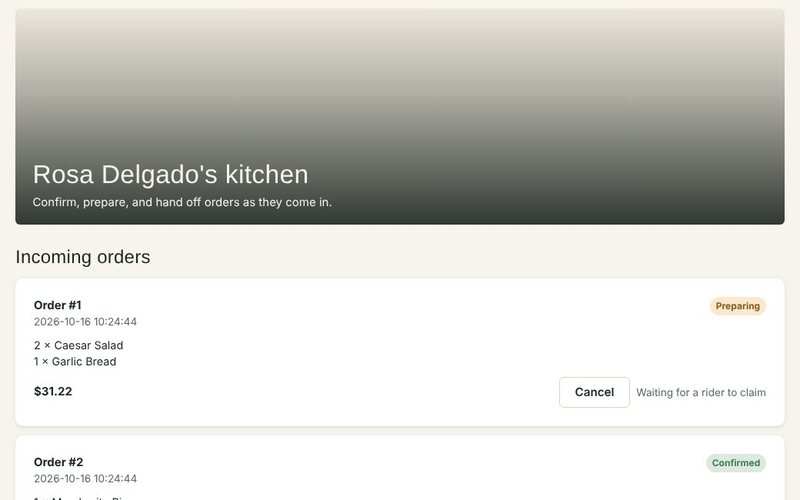
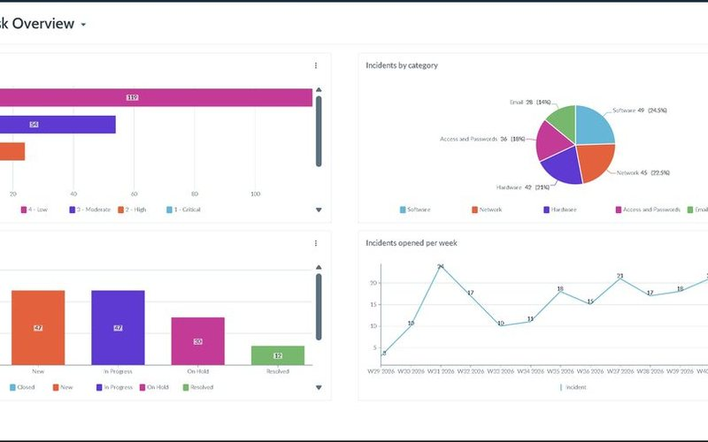
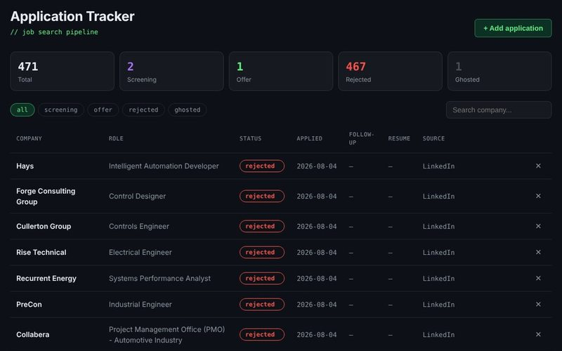
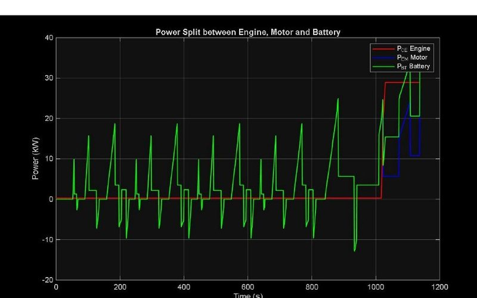
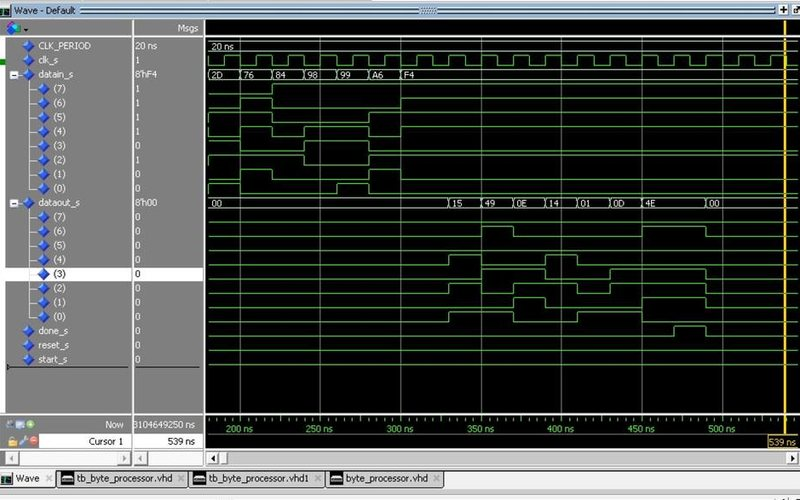
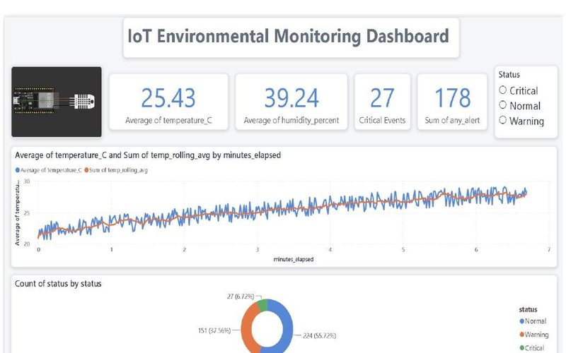
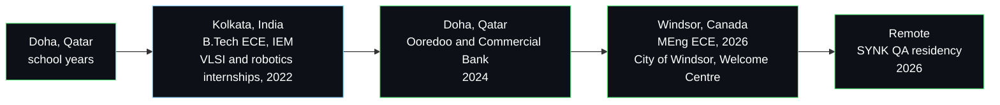

<div align="center">

<a href="https://lawazislam.com"></a>


<a href="https://lawazislam.com"></a>
<a href="https://www.linkedin.com/in/lawazislam/"></a>
<a href="mailto:lawaz.islam2002@gmail.com"></a>

<a href="https://lawazislam.com/assets/Lawaz-Islam-Resume-IT-Data.pdf"></a>
<a href="https://lawazislam.com/assets/Lawaz-Islam-Resume-Engineering.pdf"></a>


<br/><br/>

<a href="#hiring-start-here"></a>
<a href="#what-i-do"></a>
<a href="#impact-with-receipts"></a>
<a href="#featured-projects"></a>
<a href="#journey"></a>
<a href="#education-and-certifications"></a>
<a href="#connect"></a>

</div>

## Hiring? Start here

Two tracks, one person. Pick the row that matches your role and you will have the full picture in under a minute.

| If you are hiring for | Read this resume | Then open these |
|---|---|---|
| **IT support, data analysis, reporting, IT project coordination** | [IT &amp; Data resume (PDF)](https://lawazislam.com/assets/Lawaz-Islam-Resume-IT-Data.pdf) | [ServiceNow ITSM Service Desk](https://github.com/lawazislam/servicenow-itsm-service-desk) · [FreshRoute (live)](https://freshroute-arxz.onrender.com) · [IoT Power BI Dashboard](https://github.com/lawazislam/iot-environmental-dashboard) |
| **Engineering technician, controls, hardware, embedded** | [Engineering resume (PDF)](https://lawazislam.com/assets/Lawaz-Islam-Resume-Engineering.pdf) | [PHEV controller report](https://lawazislam.com/assets/reports/phev-power-management.pdf) · [VHDL on a real FPGA](https://github.com/lawazislam/reconfigurable-computing-vhdl-fpga) · [Battery Management](https://github.com/lawazislam/battery-management-ecm-soc) |

Canadian experience: City of Windsor (Sep to Dec 2025), Welcome Centre Shelter (Jan to Apr 2026) and a remote QA residency with SYNK (Aug to Oct 2026). Authorized to work for any Canadian employer, available immediately.

## Who I am

<table>
<tr>
<td width="140" valign="top"></td>
<td valign="top">

I turn messy data into clear answers, and ideas into working hardware.

I grew up in Doha, studied engineering in Kolkata, and finished my Master of Engineering in Windsor, with training stops at NASA Kennedy Space Center and the National University of Singapore along the way. Five countries and three education systems teach you one thing above all: walk into an unfamiliar setup, figure out how it actually works, then make it better.

I build things when nobody asks me to. I rewrote an old course project into a modern C++ Sudoku solver on my own time, built a full-stack game rating app during a training placement and rebuilt it two years later as a live, tested product, and co-designed the AI use-case submission process at the City of Windsor. I would rather understand the whole system before I touch a part of it, and I would rather ship something measurable than describe something impressive.

Away from work: Formula 1, football, cricket and basketball, old kits and old highlights, new places, and a Football Manager save that gets more attention than it deserves.

</td>
</tr>
</table>

```text
Role        IT & Data Analyst | Electrical & Computer Engineering Graduate (MEng)
Experience  7 placements and internships in Canada, Qatar, India and remote, 2022 to 2026
Domains     Municipal IT, non-profit operations, platform QA, telecom, banking, VLSI, robotics
Open to     IT Support Analyst, Junior Data Analyst, IT Project Coordinator,
            Reporting Analyst, Engineering Technician, anywhere in Ontario
Available   Now. PGWP, no sponsorship required
```

## What I do

Three things you can hand me and trust. Each one pairs what I understand with what I have already delivered.

<table>
<tr>
<td width="33%" valign="top">


**Turn messy data into decisions**

Reconciliation, reporting and dashboards in Power BI, DAX, SQL, Excel and Python. I clean the data, find what is wrong with it, and show leadership what it means.

**$200K+** in invoices reconciled and 10+ discrepancies caught before they reached reporting, for a shelter serving 200+ clients a year.

</td>
<td width="33%" valign="top">


**Keep systems and people running**

IT support, documentation and coordination across ServiceNow, Microsoft 365, SharePoint and Power Automate. I make it easier for staff to find answers and for projects to keep moving.

**30** ServiceNow knowledge-base articles kept and fully updated after reorganizing the department's 50+, plus co-designing the City's AI use-case submission process.

</td>
<td width="33%" valign="top">


**Build and validate hardware and control systems**

MATLAB/Simulink controllers, Verilog on FPGA, embedded firmware in C and C++, and Siemens PLC fundamentals. I do not stop at "it works"; I benchmark it.

**37.8%** gap to a dynamic programming optimum, quantified, for a hybrid vehicle controller validated across 4 drive cycles.

</td>
</tr>
</table>

<div align="center">


<br/>

<br/>


<br/><br/>


</div>

## Impact, with receipts

Every figure below names where it comes from. Nothing here is estimated for effect.

<details open>
<summary><b>All 24 numbers and their sources</b></summary>
<br/>

| Number | What | Source |
|---|---|---|
| **$200K+** | Invoices reconciled over 16 months | Welcome Centre Shelter, 2026 |
| **10+** | Discrepancies caught before reporting | Welcome Centre Shelter, 2026 |
| **200+** | Clients a year served by the organization | Welcome Centre Shelter |
| **30** | Knowledge-base articles curated from 50+, audited for public vs. internal use | City of Windsor, 2025 |
| **3** | Live web apps shipped with automated tests | job-tracker, slickscores and freshroute, this GitHub |
| **26** | Automated tests passing across all three live apps | job-tracker, slickscores and freshroute, pytest |
| **100+** | Live game titles pulled from the RAWG API | slickscores, 2026 rebuild |
| **759** | Realistic reviews generated for the demo catalogue | slickscores, seeded data |
| **27** | Critical events flagged across 402 sensor readings | IoT Dashboard report |
| **41%** | Readings found outside safe thresholds | IoT Dashboard report |
| **200** | Synthetic incidents seeded across 5 categories and 3 assignment groups | servicenow-itsm-service-desk, Part 1 |
| **0** | Data errors found by the read-only verification of the seeded incidents | servicenow-itsm-service-desk, verify_seed.js |
| **5** | ACLs configured on a custom table, including a field-level write rule | servicenow-itsm-service-desk, Part 4 |
| **18** | Access checks run across 4 user roles, including REST calls | servicenow-itsm-service-desk, Part 4 |
| **37.8%** | Controller gap to DP optimum, quantified | PHEV report, ELEC8900 |
| **71 to 98%** | Fuel reduction vs. ICE baseline, 4 drive cycles | PHEV report, ELEC8900 |
| **4+** | FPGA lab projects delivered, exam Grade A | Jadavpur University, 2022 |
| **189.83 MHz** | Max frequency reached on a real FPGA | reconfigurable-computing-vhdl-fpga |
| **153.8 Ah** | Pack capacity estimated via coulomb counting | battery-management-ecm-soc |
| **20%** | Growth in weekly attendance across 25+ meetings | IEM Toastmasters, VP Public Relations |
| **5** | Countries trained and worked in | Qatar, India, US, Singapore, Canada |
| **84%** | MEng average | University of Windsor, 2026 |
| **13** | Featured projects, each with a live app or full report | lawazislam.com/projects |
| **14** | GitHub repositories, several independently verified | github.com/lawazislam |

</details>

## Featured projects

Two tracks, one standard: every project ends in something measurable, and every one has proof you can open. The six below are the fastest way in; all thirteen are written up underneath, and every write-up expands.

<table>
<tr>
<td width="33%" valign="top">
<a href="https://freshroute-arxz.onrender.com"></a>
<br/><b>FreshRoute</b><br/>
<sub>Three-role delivery platform, server-enforced permissions, 11 tests</sub><br/>
<a href="https://freshroute-arxz.onrender.com">Live app</a> · <a href="https://github.com/lawazislam/freshroute">Source</a>
</td>
<td width="33%" valign="top">
<a href="https://github.com/lawazislam/servicenow-itsm-service-desk"></a>
<br/><b>ServiceNow ITSM Service Desk</b><br/>
<sub>200 incidents, approvals, knowledge base, 18 ACL checks</sub><br/>
<a href="https://github.com/lawazislam/servicenow-itsm-service-desk">Source</a>
</td>
<td width="33%" valign="top">
<a href="https://job-tracker-wi1r.onrender.com"></a>
<br/><b>Job Application Tracker</b><br/>
<sub>FastAPI pipeline I use for my own search, 7 tests</sub><br/>
<a href="https://job-tracker-wi1r.onrender.com">Live app</a> · <a href="https://github.com/lawazislam/job-tracker">Source</a>
</td>
</tr>
<tr>
<td width="33%" valign="top">
<a href="https://lawazislam.com/assets/reports/phev-power-management.pdf"></a>
<br/><b>Series PHEV Power Management</b><br/>
<sub>Controller within 37.8% of the DP optimum, 4 drive cycles</sub><br/>
<a href="https://lawazislam.com/assets/reports/phev-power-management.pdf">Report</a>
</td>
<td width="33%" valign="top">
<a href="https://lawazislam.com/assets/reports/reconfigurable-computing-vhdl-fpga.pdf"></a>
<br/><b>VHDL on a real FPGA</b><br/>
<sub>RTL to timing closure, 189.83 MHz on a Max 10</sub><br/>
<a href="https://lawazislam.com/assets/reports/reconfigurable-computing-vhdl-fpga.pdf">Report</a> · <a href="https://github.com/lawazislam/reconfigurable-computing-vhdl-fpga">Source</a>
</td>
<td width="33%" valign="top">
<a href="https://lawazislam.com/assets/reports/iot-environmental-dashboard.pdf"></a>
<br/><b>IoT Monitoring Dashboard</b><br/>
<sub>ESP32 to Python to Power BI, 27 critical events flagged</sub><br/>
<a href="https://lawazislam.com/assets/reports/iot-environmental-dashboard.pdf">Report</a> · <a href="https://github.com/lawazislam/iot-environmental-dashboard">Source</a>
</td>
</tr>
</table>

### Data / IT

<details open>
<summary><b>Job Application Tracker</b> · live full-stack tool with a validated API and tests</summary>
<br/>


*The tracker running on my own applications.*

A FastAPI and SQLite tracker for a real job search: an eight-stage pipeline with a full audit trail of every status change, behind a validated REST API that rejects malformed dates, impossible data and duplicate applications while deliberately allowing reapplication after a rejection. The 7-test pytest suite caught a genuine data-isolation bug in the connection layer. Deployed on Render with auto-deploy on every push.

| Stack | Scale | Impact |
|---|---|---|
| Python, FastAPI, SQLite, pytest, Render | 8 endpoints, 8 pipeline stages, 7 end-to-end tests | Replaced a spreadsheet with a deployed, validated tool; the tests found a real bug before it corrupted data |

<a href="https://job-tracker-wi1r.onrender.com"></a>
<a href="https://github.com/lawazislam/job-tracker"></a>

</details>

<details>
<summary><b>FreshRoute</b> · role-based delivery platform, live</summary>
<br/>


*The restaurant owner view: only the actions an owner is allowed.*

A three-role food delivery platform built solo with React and FastAPI, where customers, restaurant owners and riders each get a server-side-enforced set of permitted actions instead of three skins on one shared screen. Rider claiming is atomic at the database level, so two riders racing for the same order cannot both win it, and an order is not closed until the customer confirms receipt. Customers get a ten-second grace window to self-cancel, enforced by the backend's own clock. Twelve restaurants across ten cuisines ship through one cart with Haversine distance-based delivery pricing.

| Stack | Scale | Impact |
|---|---|---|
| React, FastAPI, SQLite, pytest, Render | 3 roles, 12 restaurants, 10 cuisines, 11 end-to-end tests | Role boundaries and the order lifecycle are enforced and tested on the server, not hidden in the interface |

<a href="https://freshroute-arxz.onrender.com"></a>
<a href="https://github.com/lawazislam/freshroute"></a>

</details>

<details>
<summary><b>ServiceNow ITSM Service Desk</b> · incidents, catalog requests, knowledge base and access control</summary>
<br/>


*The four-chart dashboard over 200 synthetic incidents.*

A hands-on IT service desk build on a ServiceNow Personal Developer Instance, in four parts. Seeded 200 synthetic incidents with a GlideRecord script and verified them with a read-only check that found zero data errors. Built a New Laptop Request catalog item with manager approval and four fulfillment tasks, and found and fixed a rejection path that left the requested item open. Set up a knowledge base with reader and contributor roles, where testing showed that a user with no roles could still read every article. Locked down a custom table with five ACLs and ran 18 checks across four user roles, including REST calls. All data is synthetic, and the README lists what was not tested.

| Stack | Scale | Impact |
|---|---|---|
| ServiceNow, JavaScript, GlideRecord, Platform Analytics, ACLs | 200 incidents, 5 ACLs, 18 checks across 4 roles | Testing caught a rejection path that left a request open (fixed) and a knowledge base readable by users with no roles |

<a href="https://github.com/lawazislam/servicenow-itsm-service-desk"></a>

</details>

<details>
<summary><b>SlickScores</b> · game rating platform, rebuilt and live</summary>
<br/>


*A game page with its community score and reviews.*

First built during a training placement at Ooredoo in 2024, rebuilt in 2026 with live API data and production-grade auth. The rebuild replaced roughly 25 hand-added games with a live catalogue of 100+ PlayStation titles from the RAWG API (with a fallback catalogue so it never breaks), moved password validation from the React client to server-side enforcement with salted hashes, and added a one-review-per-account rule enforced by a database constraint. A deterministic seeder generates 759 realistic reviews for an always-populated demo, backed by 8 passing pytest tests.

| Stack | Scale | Impact |
|---|---|---|
| React (Vite), Flask, SQLite, RAWG API, pytest | 100+ live titles, 759 seeded reviews, 8 tests | Turned a hardcoded training project into a real integration and surfaced three genuine bugs on the way |

<a href="https://slickscores.onrender.com"></a>
<a href="https://github.com/lawazislam/slickscores"></a>

</details>

<details>
<summary><b>IoT Environmental Monitoring &amp; Analytics Dashboard</b> · ESP32 sensor pipeline to Power BI</summary>
<br/>


*The Power BI dashboard, from the report.*

An ESP32 with a DHT22 sensor simulated in Wokwi, a Python pipeline (pandas, numpy) to clean the readings and engineer rolling averages, and a Power BI dashboard with KPI cards, a trend chart, a status donut and a custom DAX measure on top.

| Stack | Scale | Impact |
|---|---|---|
| ESP32, Wokwi, Python, Power BI, DAX | 402 readings, 3 status tiers | Flagged 27 critical events and showed 41% of readings breached safe thresholds |

<a href="https://lawazislam.com/assets/reports/iot-environmental-dashboard.pdf"></a>
<a href="https://github.com/lawazislam/iot-environmental-dashboard"></a>

</details>

### Engineering

<details>
<summary><b>Series PHEV Power Management Simulation</b> · hybrid vehicle controller benchmarked against the optimum</summary>
<br/>


*Engine, motor and battery power split over the NEDC, Figure 16 of the report.*

A rule-based thermostatic controller for a series plug-in hybrid, modeled in MATLAB/Simulink with the QSS Toolbox and validated across four standard drive cycles. Rather than stopping at "it works", the controller was benchmarked against a dynamic programming solution and cross-checked with an independent forward-dynamic model.

| Stack | Scale | Impact |
|---|---|---|
| MATLAB, Simulink, QSS Toolbox, dynamic programming | 4 drive cycles (NEDC, EUDC, FTP-75, FTP-Highway) | 71 to 98% fuel reduction vs ICE baseline; gap to DP optimum quantified at 37.8% |

<a href="https://lawazislam.com/assets/reports/phev-power-management.pdf"></a>

</details>

<details>
<summary><b>Verilog &amp; FPGA Lab: Digital Systems</b> · real hardware on Artix-7</summary>
<br/>


*The Nexys 4 Artix-7 board running the 7-segment display project.*

The first of three practicals from a VLSI Design summer training program at Jadavpur University's IC Design and Fabrication Centre. Real-time FPGA systems built on Artix-7: 7-segment and LCD display drivers, shift registers, counters and clock division, on top of adders, decoders and multiplexers designed in Verilog and verified in Xilinx Vivado. Every module in the repo is independently verified to compile with Icarus Verilog. Group lab report.

| Stack | Scale | Impact |
|---|---|---|
| Verilog, Xilinx Vivado, Artix-7 (Nexys 4) | 4+ lab projects | Exam Grade A; every design verified in simulation before it went to hardware |

<a href="https://lawazislam.com/assets/reports/verilog-fpga-lab.pdf"></a>
<a href="https://github.com/lawazislam/verilog-fpga-lab"></a>

</details>

<details>
<summary><b>EDA (Digital &amp; Analog) Lab</b> · CMOS circuit design in T-Spice</summary>
<br/>


*T-Spice output: input square wave and inverted output of a CMOS inverter.*

The second of three practicals from the same Jadavpur training program. Fifteen CMOS circuits, digital and analog, designed and simulated transistor-level in T-Spice: inverters, NAND/NOR gates, transmission-gate logic, and a buffer built from a reusable subcircuit on the digital side; a current mirror, a differential amplifier, and an LC voltage-controlled oscillator on the analog side. Group lab report.

| Stack | Scale | Impact |
|---|---|---|
| T-Spice, CMOS transistor-level design | 15 circuits, digital and analog | Same tool covering logic gates through to an oscillator, transistor-level throughout |

<a href="https://lawazislam.com/assets/reports/eda-analog-digital-lab.pdf"></a>

</details>

<details>
<summary><b>Microelectronics Lab</b> · silicon IC fabrication, hands-on cleanroom work</summary>
<br/>


*The thermal vacuum evaporation machine used for metal deposition.*

The third of three practicals from the same Jadavpur training program. Hands-on coverage of the core silicon fabrication process: cleaning, oxidation, photolithography, diffusion, and metallization, including operating a thermal vacuum evaporation machine to deposit Aluminium and Silver thin films onto a masked wafer. Physical process work, no source code applies. Group lab report.

| Stack | Scale | Impact |
|---|---|---|
| Silicon wafer fabrication, thermal vacuum evaporation, diffusion pump systems | Full fabrication sequence | Direct hands-on exposure to how a chip is physically made, not just designed |

<a href="https://lawazislam.com/assets/reports/microelectronics-fabrication-lab.pdf"></a>

</details>

<details>
<summary><b>Sudoku Generator &amp; Solver</b> · modern C++17 console app</summary>
<br/>


*A generated medium-difficulty puzzle, from the report.*

Recursive backtracking fills a randomized valid grid, then cells are removed one at a time while a solution counter proves the puzzle still has exactly one answer. Three difficulty levels, rule-checked interactive play, reveal on demand. A rewrite of an early OOP course project into portable, standard-library C++17 with all state in a single class.

| Stack | Scale | Impact |
|---|---|---|
| C++17, STL, recursive backtracking | 9x9 grid, 3 difficulty levels | Guaranteed unique-solution generation, not just random cell removal |

<a href="https://lawazislam.com/assets/reports/sudoku-generator-solver.pdf"></a>
<a href="https://github.com/lawazislam/sudoku-generator-solver"></a>

</details>

<details>
<summary><b>Voice-Controlled WiFi Home Automation</b> · ESP8266 relay control from a phone</summary>
<br/>


*NodeMCU ESP8266, four-channel relay module and four LED channels, from the report.*

NodeMCU ESP8266 firmware that joins the local WiFi network, runs a small web server and switches a four-channel relay module from an Android app's buttons or voice commands, over IP-based HTTP.

| Stack | Scale | Impact |
|---|---|---|
| NodeMCU ESP8266, Arduino IDE (C/C++), Android app | 4 independent relay channels | The complete path from a phone command to a physical switching action |

<a href="https://lawazislam.com/assets/reports/wifi-home-automation.pdf"></a>
<a href="https://github.com/lawazislam/wifi-home-automation"></a>

</details>

<details>
<summary><b>Battery Management: ECM &amp; SOC Estimation</b> · MATLAB/Simulink, independently re-verified</summary>
<br/>


*Nyquist impedance plot of the 2RC battery model, from the report.*

Two Advanced Energy Storage Systems projects covering core Battery Management System functions. Built a 2RC equivalent circuit model in MATLAB, ran a Nyquist impedance analysis, and scaled it to a 110S72P EV-scale pack simulated under real UDDS and HWFET drive cycles. Separately, built a Simulink implementation of rest-detection capacity estimation and coulomb-counting SOC tracking. Every reported result was independently re-verified: re-ran the MATLAB code in Octave and reproduced every value exactly, then cross-checked every parameter against the official assignment sheet, which surfaced and fixed a real discrepancy in the simulation sampling time.

| Stack | Scale | Impact |
|---|---|---|
| MATLAB, Simulink, Octave | 2 combined projects, cell model to 110S72P pack | 153.8 Ah pack capacity estimated; every result independently reproduced and cross-checked against the assignment spec |

<a href="https://lawazislam.com/assets/reports/battery-management-ecm-soc.pdf"></a>
<a href="https://github.com/lawazislam/battery-management-ecm-soc"></a>

</details>

<details>
<summary><b>Reconfigurable Computing: VHDL on FPGA</b> · synthesized and timed on a real Max 10 FPGA</summary>
<br/>


*Questa waveform: all 7 byte differences and the done pulse, independently reproduced with GHDL.*

Three assignments progressing from basic combinational and sequential building blocks through a full RTL-to-synthesis-to-timing-closure flow on a real Intel FPGA. Built a 12-bit counter two ways, structurally and behaviorally, to directly compare both VHDL design methodologies; an 8-bit universal shift register and a generic n-bit sequential restoring binary divider, synthesized at four bit-widths; and a complete 4-state FSM byte-processing system synthesized in Intel Quartus Prime to a Max 10 FPGA. Co-authored with Kamran Shahid. Every design was independently re-verified by compiling and simulating all of them with GHDL, including 6 original test vectors for the divider.

| Stack | Scale | Impact |
|---|---|---|
| VHDL, Intel Quartus Prime, ModelSim/Questa, GHDL | 3 assignments, 9 designs | Synthesized to 189.83 MHz on real hardware (192 logic elements, 83 registers); every design independently re-verified |

<a href="https://lawazislam.com/assets/reports/reconfigurable-computing-vhdl-fpga.pdf"></a>
<a href="https://github.com/lawazislam/reconfigurable-computing-vhdl-fpga"></a>

</details>

### More on GitHub

Smaller builds and earlier coursework, kept here because the code is worth reading.

<details>
<summary><b>Client-Server Chat System</b> · multi-threaded Python over TCP sockets</summary>
<br/>

A multi-threaded chat server in Python: one server handles several clients at once over TCP sockets, using a fixed-length header protocol so the receiver always knows exactly how many bytes to read next. Broadcast messages to everyone or a private `@username` message to one person. Built with Sayantan Sarkar for a Computer Networks Lab practical.

| Stack | Scale | Impact |
|---|---|---|
| Python, socket, threading, select | Concurrent multi-client handling | Framing protocol and concurrent connection handling built from raw sockets, no framework |

<a href="https://github.com/lawazislam/client-server-python"></a>

</details>

<details>
<summary><b>CDMA Signal Transmission &amp; Reception</b> · MATLAB/Octave, verified bit-exact</summary>
<br/>

A simulation of Code Division Multiple Access: four users transmit simultaneously over one shared channel, each spread with their own Walsh code, and the receiver recovers every user's data exactly, with zero bit errors, by exploiting the orthogonality of those codes. Built with Sayantan Sarkar for a Communication Lab practical.

| Stack | Scale | Impact |
|---|---|---|
| MATLAB/Octave | 4 simultaneous users, 8-bit streams | Reconstruction verified bit-for-bit against the original transmitted data, zero error |

<a href="https://github.com/lawazislam/cdma-signal-simulation"></a>

</details>

<details>
<summary><b>ROS Noetic + Gazebo: TurtleBot3 Simulation</b> · robotics environment setup</summary>
<br/>

Setting up a full ROS robotics simulation environment from scratch: installing ROS Noetic, building a catkin workspace, and getting a TurtleBot3 Waffle model running in Gazebo with its camera, laser, and differential-drive plugins all initializing cleanly, inside a VirtualBox VM. Documented with real photos from the actual build and run.

| Stack | Scale | Impact |
|---|---|---|
| ROS Noetic, Gazebo, catkin, Ubuntu (VirtualBox) | Full sim stack: camera, laser, diff-drive plugins | Environment built and verified end to end, from a blank VM to a running robot simulation |

<a href="https://github.com/lawazislam/ros-gazebo-turtlebot3"></a>

</details>

<details>
<summary><b>To Your Door</b> · Android food delivery app, four-person capstone</summary>
<br/>

A four-person capstone Android app for food delivery, covering both the customer side (restaurant discovery, cart, checkout, live order tracking) and the restaurant side (menu and order management). Built with Ishu Kumar, Anchal Kumari, and Arko Paul, supervised by Prof. Tapan Kumar Rana. My contribution was spread across the app rather than one isolated piece.

| Stack | Scale | Impact |
|---|---|---|
| Kotlin, Android Studio, Firebase, Google Maps API, Razorpay | Full customer + restaurant flow | Complete order lifecycle: discovery to checkout to real-time tracking |


</details>

## Journey

Doha to Kolkata to Windsor. The route first, then every role, newest first; the two Windsor placements are where the deepest work happened.



**Remote · 2026**

**Technical QA &amp; Platform Tester (Dev Cohort) · SYNK** · Aug to Oct 2026 · Internship
- Selected for a technical residency to stress-test Synk's spatial audio platform, logging 3,600+ minutes of active session testing to identify browser rendering lag and memory spikes during multi-user load events
- Used the residency timeline to ship two independent projects: [FreshRoute](https://github.com/lawazislam/freshroute), a multi-role delivery platform with a server-side state machine and atomic database writes, and the [ServiceNow ITSM Service Desk](https://github.com/lawazislam/servicenow-itsm-service-desk), with 200 scripted synthetic incidents and ACL rules verified by impersonation
- Authored a combined suite of 25+ automated tests (pytest and server-side scripts) to verify business logic across both

`QA testing` `Performance testing` `pytest` `FastAPI` `ServiceNow`

**Windsor, Canada · 2025 to 2026**

**Data Manager · Welcome Centre Shelter for Women and Families** · Jan to Apr 2026
- Reconciled 100+ invoice records worth $200K+ over 16 months for a non-profit serving 200+ clients, and caught 10+ discrepancies before they reached the operational reports
- Analyzed a year of performance data and gave leadership month-over-month and year-over-year trends they could act on
- Kept confidential records to regulated community-care standards; Naloxone-certified

`Excel` `Power BI` `Data reconciliation` `Reporting`

**IT Project Coordinator and Researcher · City of Windsor** · Sep to Dec 2025
- Reorganized and refreshed the ServiceNow knowledge base, cutting 50+ articles to about 30 by removing irrelevant entries and updating the rest, deciding what stays internal versus citizen-visible
- Co-designed the AI Use Case submission process: form structure, question flow, prioritization criteria
- Supported active IT projects under the Technology Strategy and Operations team with feasibility checks and documentation

`ServiceNow` `SharePoint` `Microsoft 365` `Power Automate` `Documentation`

**Doha, Qatar · 2024**

**Telecom Operations Intern · Ooredoo** · Sep to Oct 2024
- Produced 5+ internal reports in SQL and Python for a live telecom team of 20+ and flagged data irregularities for follow-up
- Built the first version of SlickScores (React, Flask, SQL) on my own during the placement

`SQL` `Python` `React` `Flask`

**IT Project Intern · Commercial Bank** · Aug to Sep 2024
- Built 3+ management reports in Power BI and Excel for the Customer Insights Technology team, pulling data from several systems into one clear view
- Learned CRM fundamentals and the bank's internal processes under direct mentorship, then made data-quality updates to customer records

`Power BI` `Excel` `CRM`

**Kolkata, India · 2022**

**VLSI Design Intern · Jadavpur University, IC Design and Fabrication Centre** · Sep to Nov 2022
- Delivered 4+ FPGA lab projects on Xilinx Vivado and Artix-7 (counters, display controllers, shift registers), then earned Grade A on the program's written exam
- Wrote the formal technical report for each project, covering design method and verification results

`Verilog` `Xilinx Vivado` `FPGA`

**Robotics Intern · SmartKnower** · Aug to Oct 2022
- Set up ROS on a virtual Ubuntu machine, built a catkin workspace and ran the TurtleBot 3 Waffle model in Gazebo
- Built servo motor control systems on Arduino

`ROS` `Gazebo` `Arduino`

**Programs abroad · 2019 and 2022**

- **AI, IoT and Data Analytics Program · National University of Singapore** · Sep 2022: group project work presented to an NUS faculty panel
- **Aerospace Engineering Program · NASA Kennedy Space Center** · Sep 2019: led a team of 4 to design, analyze and launch a water-bottle rocket

## Side quests

What I build and lead when nobody is making me.

| | What | Where |
|---|---|---|
| Leadership | **Vice President of Public Relations**: grew weekly attendance 20% through outreach across 3+ districts and ran logistics for 25+ meetings. First Runner-Up, Detox 1.0 speaking contest | IEM Toastmasters Club, 2022 |
| Leadership | **Sergeant-at-Arms**, two terms: meeting logistics, setup and hybrid-meeting tech support | IEM Toastmasters Club, 2021 and 2022 |
| Leadership | **Delegate, UWill Discover Model United Nations**: represented Rwanda and co-drafted a working paper on financing sustainable development | University of Windsor, 2025 |
| Community | **Moderator, UWin UNIfy**: selected to moderate a campus community platform, enforcing guidelines and resolving conflicts | University of Windsor, 2025 to 2026 |
| Community | **Volunteer**: Relay for Life event day committee, Mental Health Association fundraising, Celebration of Nations, Good Greens food reclamation, Campus Community Garden | University of Windsor, 2025 to 2026 |
| Community | **Scout**: structured leadership and field-operations training; led small teams during camps | Ideal Indian School, Doha, 2016 to 2018 |

## Education and certifications

<div align="center">


<br/>


</div>

<details>
<summary><b>Certifications (18)</b> · data and IT, engineering, safety</summary>
<br/>

<div align="center">

**Data and IT**<br/>


<br/><br/>
**Engineering**<br/>


<br/><br/>
**Safety**<br/>


</div>

</details>

## Skill signal

Self-generated from the same Expertise table on the site, not a template. The levels are ordinal, taken from the site's own wording (Project level, Internship level, Graduate coursework, Deployed and tested, Working professionally), not an invented numeric score.

<div align="center">


</div>

## GitHub activity

<div align="center">


<br/><br/>

<a href="https://github.com/lawazislam/freshroute"></a>
<a href="https://github.com/lawazislam/servicenow-itsm-service-desk"></a>
<a href="https://github.com/lawazislam/job-tracker"></a>
<a href="https://github.com/lawazislam/slickscores"></a>


<br/><br/>


</div>

## Current focus

```yaml
learning:
  - Siemens TIA Portal beyond the fundamentals cert (ladder logic, FBD, industrial sensors)
  - Deeper Power BI modeling and DAX for operational reporting
building:
  - freshroute: role-based delivery platform with a server-side order state machine
  - servicenow-itsm-service-desk: incidents, approvals, knowledge base and ACL testing
  - job-tracker: the eight-stage pipeline I use for my own search
  - slickscores: the 2026 rebuild (live RAWG catalogue, server-side auth, pytest)
  - lawazislam.com: a portfolio where every number has a receipt
exploring:
  - AI tooling in real workflows, after co-designing the City of Windsor's AI use-case intake process
  - Applying the PHEV dynamic-programming benchmark to adaptive control
open_to:
  - IT Support Analyst, Junior Data Analyst, IT Project Coordinator, Reporting Analyst, Engineering Technician
  - Anywhere in Ontario, available now, PGWP, no sponsorship required
```

## Connect

<div align="center">

If you are hiring for IT support, data analytics, project coordination or engineering roles in Ontario, I would genuinely like to hear from you. Email is the fastest way; my LinkedIn messages are open.

<br/>

<a href="https://lawazislam.com"></a>
<a href="https://www.linkedin.com/in/lawazislam/"></a>
<a href="mailto:lawaz.islam2002@gmail.com"></a>
<a href="https://lawazislam.com/assets/Lawaz-Islam-Resume-IT-Data.pdf"></a>
<a href="https://lawazislam.com/assets/Lawaz-Islam-Resume-Engineering.pdf"></a>

<br/><br/>

*Figure out the system fast, then make it better.*


</div>
